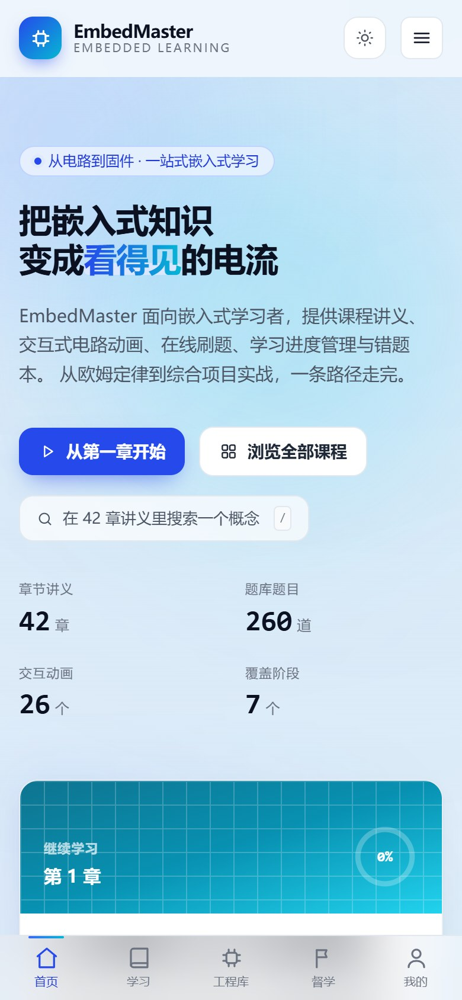
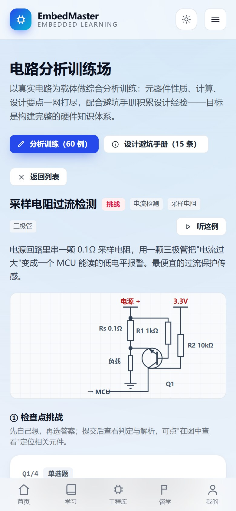
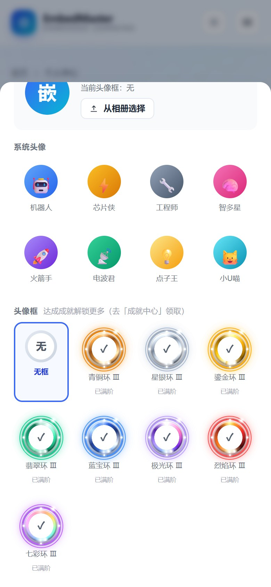

# EmbedMaster · 嵌入式学习平台

> 从欧姆定律到 RTOS，把嵌入式知识变成**看得见的电流**。

一个面向嵌入式学习者的前端应用：42 章讲义、260 道题、60 例电路分析训练、35 个元器件词条、47 个可复用代码模块、7 个完整工程、4 条理论轨道、24 项成就与 8 款可变阶头像框，外加「闭着眼睛也能学」的音频听学频道。

**纯前端 + 全本地数据**：不需要后端、不需要数据库、不需要注册，`npm install && npm run dev` 就能跑起来。

[](https://vuejs.org/)
[](https://vite.dev/)
[](https://www.typescriptlang.org/)
[](https://tailwindcss.com/)
[](./LICENSE)

---

## 预览

| 首页 | 电路分析训练场 |
| :---: | :---: |
|  |  |
| **冥想听学（音频）** | **头像框装扮（24 项成就 / 8 款框 / Ⅲ 阶材质）** |
|  |  |

更多截图见 [`docs/screenshots`](./docs/screenshots)。

### 在线体验

| 渠道 | 地址 |
| --- | --- |
| 网页版（手机/桌面均可） | https://embedmaster-learning.app.workbuddy.host/?sharecode=ZHZM54FTXL |
| Android APK（含全部音频，约 181 MB） | https://embedmaster-learning.app.workbuddy.host/EmbedMaster.apk?sharecode=ZHZM54FTXL |

---

## 为什么做这个

大多数嵌入式教程的痛点不是「没内容」，而是**知识之间没有接口**：讲义讲欧姆定律，题库考欧姆定律，但真到画一个限流电阻时，没人告诉你它和「三极管基极电流」是同一件事。

EmbedMaster 试图把这条链路接起来：

- 每道电路案例都能**点元件看参数**，并在「元器件百科」里反向跳转到用到它的真实案例；
- 每个代码模块都标注它对应的**硬件场景**与**常见坑**；
- 每个工程都拆成阶段 + 小节，完成度直接进成就系统；
- 累到睁不开眼时，还可以用**音频**把同一份内容再讲一遍。

---

## 功能

| 模块 | 内容 | 说明 |
| --- | --- | --- |
| 课程讲义 | 42 章、260 道题 | markdown-it + KaTeX 渲染，章节内嵌 26 个 Konva 交互动画 |
| 电路分析训练场 | 60 例 + 15 条避坑 | 按「入门 → 进阶 → 挑战 → 实战」分级，每例含元件定位、计算、检查点选择题 |
| 元器件百科 | 35 个词条 / 6 大类 | 参数表怎么读 → 选型决策 → 典型应用 → 避坑，双向关联电路案例 |
| 数据手册索引 | 官方外链 + 内嵌详情 | 按词条挂载，避免到处翻 PDF |
| 代码库 | 47 个模块 / 12 类 | 场景代码 + 要点 + 关联训练资源，含 10 个 ESP-IDF 模块 |
| 工程库 | 7 个项目 / 阶段化 | 每项目分阶段与小节，进度可勾选，支撑「从零做一个东西」 |
| 理论轨道 | 4 条 / 49 节 | 语言基础、计算机底层、C 语言大全（嵌入 / 通用双轨）、Python |
| 冥想听学 | 5 个心法频道 + 6 个课程精听 | 稿件由正文派生，音频不入库（见下文），缺失时回退浏览器 TTS |
| ESP32 专区 | 家族对比 + STM32 差异 | 迁移视角看寄存器与 RTOS 的差别 |
| 督学 | 八阶段路线图 + 签到 + 热力图 | 连续天数、累计天数、8 周热力图 |
| 错题本 | 艾宾浩斯复习 + 六维雷达 | 按遗忘曲线排复习，雷达定位薄弱维度 |
| 成就与头像框 | 24 项成就 / 8 款框 / 每框 Ⅰ→Ⅲ 阶 | 同一款框可「进阶」，材质环随阶位长出领环、宝石钉、光晕 |
| AI 答疑 | DeepSeek / 通义 / Kimi / GLM / Ollama / 自定义 | 流式 SSE，可注入错题本摘要；**Key 只存本地**，无服务端中转 |
| 学习周报 | 本周时长、答题、章节、薄弱点 | 可生成演示数据，便于展示 |
| PWA / Android | 可安装、可离线 | Capacitor 打包，Service Worker 预缓存静态资源 |

---

## 技术栈

| 层次 | 选型 |
| --- | --- |
| 框架 | Vue 3（`<script setup>` + TypeScript） |
| 构建 | Vite 6 |
| 样式 | TailwindCSS 3（自定义设计令牌，见 `tailwind.config.js`） |
| 路由 | Vue Router 4（hash 模式，静态托管无需重写规则） |
| 讲义渲染 | markdown-it + KaTeX |
| 交互动画 | Konva 9（Canvas 2D，无第三方组件封装） |
| 图标 | 内置内联 SVG（`AppIcon.vue`），零运行时依赖 |
| 状态持久化 | localStorage（模拟 `user_progress` / `user_answer` 等表） |
| 移动端 | Capacitor 6 + Android WebView |
| 质量保障 | vue-tsc + Puppeteer 巡检脚本 |

除上述开源库外没有闭源依赖，也没有付费服务。

---

## 快速开始

环境要求：Node.js ≥ 18（推荐 20 / 22）。

```bash
npm install
npm run dev          # http://127.0.0.1:5173
```

演示账号：`demo` / 任意 6 位以上密码（也可直接注册，数据只存在本机浏览器）。

生产构建与本地预览：

```bash
npm run build        # 产物在 dist/
npm run preview      # http://127.0.0.1:4173
npm run type-check   # vue-tsc 类型检查
```

> 构建默认不清空 `dist/`（便于保留音频等外部资源）。需要彻底重建时用 `npm run clean:dist`。
> 若在 Windows 上遇到 esbuild 删除临时文件报 `Access is denied`，把临时目录指到项目内即可：
> `TMP=$(pwd)/.tmpbuild TEMP=$(pwd)/.tmpbuild npx vite build --outDir dist-new`

---

## 目录结构

```
.
├─ src/
│  ├─ views/          # 23 个页面（首页、课程、电路、工程、听学、督学、个人中心…）
│  ├─ components/     # 通用组件（头像框 FrameRing、导航、图标、电路画布…）
│  ├─ composables/    # 组合式逻辑（鉴权、成就、语音合成、主题…）
│  ├─ mock/           # 全部内容数据：讲义章节、题库、电路案例、代码库、项目、词条…
│  │  └─ learn/       # 4 条理论轨道的正文
│  ├─ content/        # 42 章讲义 markdown 原文
│  ├─ api/            # Mock 接口层（对接真实后端的唯一改动点）
│  ├─ router/         # 路由表
│  └─ utils/          # 存储、报告生成等工具
├─ public/            # 静态资源（img / 图标 / manifest / sw.js；音频见下文）
├─ docs/screenshots/  # README 展示图
├─ verify-*.mjs       # 页面巡检脚本（Puppeteer）
├─ audit-*.mjs        # 电路图 / 标签一致性审计
├─ gen-*.py           # 音频生成脚本（edge-tts）
└─ export-*.mjs       # 由正文导出讲稿（供音频生成使用）
```

---

## 数据从哪来

所有内容都是**仓库内的 TypeScript 数据**，没有网络请求：

| 数据 | 位置 |
| --- | --- |
| 课程与题库 | `src/mock/data.ts`（42 章 / 260 题） |
| 理论轨道 | `src/mock/learn/*.ts` |
| 电路案例 | `src/mock/circuits*.ts`（60 例） |
| 避坑手册 | `src/mock/designPitfalls.ts` |
| 代码库 | `src/mock/codelib*.ts`（47 模块） |
| 工程库 | `src/mock/projects*.ts`（7 项目） |
| 元器件 / 手册 | `src/mock/components.ts`、`datasheets.ts` |
| 成就与头像框 | `src/mock/achievements.ts` |

**换成真实后端**：`src/api/index.ts` 里每个函数都是 `async` 且返回 `{ code, message, data }`，把函数体换成 `fetch` / `axios` 即可，视图层不用改。鉴权目前是 Mock 三段式 JWT，**真实部署请换成服务端签发并校验**，密码必须用 bcrypt / argon2。

学习进度、答题记录、收藏、成就等写在 `localStorage`（统一前缀 `embedmaster:`），换域名或清缓存会从零开始。

---

## 音频（不在仓库里）

全站约 **340 段 / 13 小时** 语音（讲义精听 205 段、心法 20 段、课程与工程讲解等），总计 **176 MB**，因此**没有入库**：

1. 体积太大（`public/audio/` 全量 176 MB）；
2. 它是正文的**派生数据**，可一键重新生成；
3. 语音由 edge-tts 合成，公开发布合成音频涉及第三方声音授权，仓库只保留生成脚本更稳妥。

仓库里保留的生成链：

```bash
pip install edge-tts            # 另需 ffmpeg（必须带 libmp3lame）
node export-listen.mjs          # 由正文导出讲稿 → listen-scripts.json
python gen-listen-audio2.py     # 分块合成 → public/audio/listen/*.mp3 + manifest.json
python listen-fixup.py          # 统一转 32kbps 单声道并重建 manifest
node check-listen.mjs           # 校验时长与文本是否对得上
```

其他同类脚本：`gen-learn-audio.py`（讲义）、`gen-meditate-audio.py`（心法）、`gen-project-audio.py`（工程）、`audio-validate.py`（完整性）。

**两个踩过的坑，供复用者避开**：

- `edge_tts.Communicate(整篇长文本).save()` 会在 70%~90% 处**静默截断**，时长看起来还正常。必须按句切块（≤420 字）逐块合成再拼接，并用「总时长 ≈ 各块时长之和」做校验。
- ffmpeg 有的构建只带 `mp3_mf`，指定 `-b:a 32k` 会产出 200 字节的空文件；转码要显式 `-c:a libmp3lame`。

音频缺失时应用**不会崩**：心法频道回退浏览器 Web Speech TTS，课程精听频道显示为空。

---

## 打包 Android

```bash
npm run build
npm i -D @capacitor/cli
npx cap add android
npx cap copy android
cd android && ./gradlew assembleDebug
# 产物：android/app/build/outputs/apk/debug/app-debug.apk
```

`capacitor.config.json` 里 `webDir` 指向 `dist`。APK 因体积（180 MB+）未入库，需要的话自行构建或下载发布版。

---

## 部署

产物是纯静态文件，hash 路由不需要服务端重写：

```bash
npm run build
# 把 dist/ 整个目录丢给 Vercel / Cloudflare Pages / Nginx / 对象存储均可
```

若用子路径部署，构建前设置 `base`（`vite.config.ts`），并保证 `public/audio` 的相对路径一并生效。

---

## 质量保障

仓库带一组 Puppeteer 巡检脚本（需本机 Chrome，路径写在脚本顶部）：

```bash
node server.mjs                      # 起一个本地静态服务预览 dist/
node verify-all-pages.mjs            # BFS 遍历全站 66 条路由，查白屏 / 报错
node verify-key-pages.mjs            # 71 条定向路由（章节、课程、理论轨道…）
node verify-frames.mjs               # 成就与头像框：24 项、每框 3 项、Ⅰ/Ⅱ/Ⅲ 领环结构
node audit-circuits.mjs              # 电路图元件与标注一致性
```

当前状态：类型检查 0 错误，全站巡检 0 异常，头像框专项 16/16。

---

## 已知边界

- 无真实后端：鉴权、进度、收藏全部本地 Mock，多设备不同步。
- 讲义正文不含图片（内容本身不依赖图片）。
- Konva 动画是教学级物理模型（简单数值积分），不建模器件容差与温漂。
- AI 答疑需要自备 API Key，直连各家接口，能否跨域取决于服务商。
- 音频未入库，克隆后「课程精听」为空，需按上文自行生成。

---

## 参与贡献

欢迎 Issue / PR。内容勘误（电路参数、代码笔误、讲义表述）尤其欢迎，请附上来源或推导过程。

改动前建议先跑一遍 `npm run type-check` 与 `node verify-all-pages.mjs`。

---

## 协议

代码以 [MIT](./LICENSE) 协议开源，可自由使用、修改、商用，保留版权声明即可。

内容与素材的额外说明：

- 讲义、题库、电路案例、代码模块等文字内容同样按 MIT 提供，转载注明出处即可。
- `public/img` 中的实物示意图由 AI 生成，可随仓库一并使用。
- 语音由 edge-tts 合成，**不在仓库内**；若自行生成后分发，请自行确认所用语音服务的使用条款。
- 引用的第三方库（Vue、Vite、Konva、KaTeX、markdown-it、Tailwind 等）遵循各自协议。
